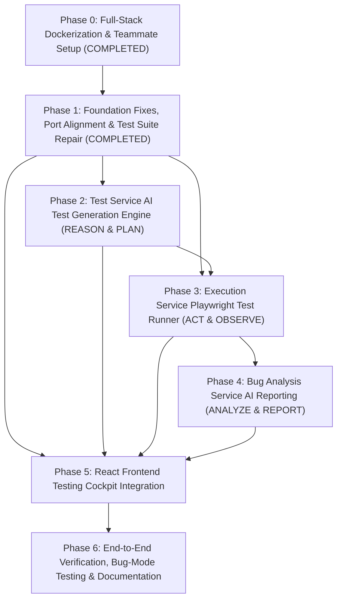

# AI Test Agent — Comprehensive Project Gap Analysis & Implementation Roadmap

> **Document Version:** 1.0.0  
> **Date:** November 21, 2026  
> **Project Title:** AI Test Agent: Autonomous AI-Based Web Application Testing and Intelligent Bug Reporting  
> **Authors / Students:** Smit Patel (23BCP115), Meet Prajapati (23BCP265)  
> **Institution:** Pandit Deendayal Energy University (PDEU), Gandhinagar  
> **Target System:** Microservices-based Autonomous AI Web Application Testing Platform

---

## Executive Summary

The **AI Test Agent** project automates the entire manual software testing lifecycle through an agentic closed-loop architecture:
$$\text{OBSERVE} \longrightarrow \text{REASON} \longrightarrow \text{PLAN} \longrightarrow \text{ACT} \longrightarrow \text{OBSERVE RESULT} \longrightarrow \text{ANALYZE} \longrightarrow \text{REPORT}$$

A fundamental architectural principle defined in the project report is the **strict separation between AI reasoning and deterministic browser automation**:
- **AI/LLM**: Understands page structure, infers workflows, produces structured JSON test plans, and performs failure analysis to write developer-ready bug reports. The LLM **never** executes browser code directly.
- **Playwright**: Acts as the deterministic execution engine, performing real browser interactions (`navigate`, `fill`, `click`, `wait`, `assert`, `screenshot`).
- **Spring Boot Microservices**: Provides the control plane, data persistence (database-per-service), API routing, service discovery, and inter-service coordination.
- **React Frontend**: Provides a single-pane-of-glass dashboard for testing engineers.

Following an exhaustive inspection of both the project report and the actual codebase across all 7 backend microservices, the frontend, the demo application, and the database configurations, this document provides a rigorous gap analysis, prioritized task list, phased implementation roadmap, ready-to-run Antigravity prompts for every phase, and an end-to-end acceptance checklist.

---

## 1. Project Requirements & Architectural Specifications

### 1.1 Functional Requirements (FR-1 to FR-11)

| Req ID | Requirement Description | Report Reference | Core Architectural Component |
| :--- | :--- | :--- | :--- |
| **FR1** | User registration and authentication protected by JWT-based tokens. | Section 3.4, FR1; Sec 4.5 | `auth-service`, `api-gateway` |
| **FR2** | Accept and validate the target web application URL. | Section 3.4, FR2; Sec 4.8 | `frontend`, `exploration-service` |
| **FR3** | Open the target application in a browser and discover pages, links, buttons, inputs, and forms. | Section 3.4, FR3; Sec 4.8 | `exploration-service` (Playwright) |
| **FR4** | Build and persist structured page representations in `exploration_db`. | Section 3.4, FR4; Sec 3.10 | `exploration-service` (PostgreSQL) |
| **FR5** | Use an LLM to identify functional workflows and generate structured test cases. | Section 3.4, FR5; Sec 4.9 | `test-service` (LLM API) |
| **FR6** | Deterministically validate and store generated JSON test cases in `test_db`. | Section 3.4, FR6; Sec 4.15 | `test-service` (PostgreSQL) |
| **FR7** | Execute selected test cases against the real web application using Playwright. | Section 3.4, FR7; Sec 4.10 | `execution-service` (Playwright) |
| **FR8** | Classify execution outcomes deterministically as `PASS`, `FAIL`, `TIMEOUT`, or `ERROR`. | Section 3.4, FR8; Table 5.2 | `execution-service` |
| **FR9** | Capture failure evidence (error logs, step state, failure screenshot) and store in `execution_db`. | Section 3.4, FR9; Sec 4.17 | `execution-service` (PostgreSQL) |
| **FR10** | Generate structured bug reports (title, severity, description, steps to reproduce, expected/actual, affected area, evidence) via LLM. | Section 3.4, FR10; Table 4.3 | `bug-service` (LLM API, `bug_db`) |
| **FR11** | Present all tests, execution histories, live statuses, and bug reports in a unified React dashboard. | Section 3.4, FR11; Sec 4.3 | `frontend` (React + Vite) |

### 1.2 Non-Functional Requirements & Architectural Constraints
- **Modularity:** 7 independent Spring Boot microservices + React Dashboard + Demo Target App.
- **Security:** Password hashing with BCrypt; stateless JWT tokens evaluated at API Gateway and Auth Service; no passwords logged or exposed in DTOs.
- **Database-per-Service Isolation:** `auth_db`, `exploration_db`, `test_db`, `execution_db`, and `bug_db`. **No service may query another service's database directly.** Communication happens strictly via REST APIs.
- **Deterministic Verdicts:** Test pass/fail decisions must come from deterministic assertions evaluated by Playwright in a real browser, never from LLM hallucination.
- **Service Discovery:** Services resolve each other dynamically via Netflix Eureka (`service-registry`) or routed through Spring Cloud Gateway.

---

## 2. In-Depth Workspace Audit & Gap Analysis

Each component was verified through source code inspection, dependency analysis, and test execution runs.

```
+---------------------------------------------------------------------------------------------------------+
|                                    IMPLEMENTATION STATUS OVERVIEW                                       |
+---------------------------------------------------------------------------------------------------------+
| Component                | Implemented | Status Category                 | Core Issues Found            |
+--------------------------+-------------+---------------------------------+------------------------------+
| Service Registry (8761)  | 100%        | Fully Implemented               | None. Eureka works properly. |
| API Gateway (8080)       | 70%         | Implemented but Misconfigured   | Port collision (8082 vs 8080)|
| Auth Service (8081)      | 85%         | Partially Implemented / Broken  | Test config missing JWT keys |
| Exploration Svc (8082)   | 80%         | Partially Implemented / Broken  | Test throws ResourceNotFound |
| Test Service (8083)      | 20%         | Mock / Stub Only                | No LLM, no steps, hardcoded  |
| Execution Service (8084) | 15%         | Mock / Stub Only                | No Playwright runner invoked |
| Bug Service (8085)       | 20%         | Mock / Stub Only                | No LLM, hardcoded mock bugs  |
| React Frontend (5173)    | 25%         | Partially Implemented (Skeleton)| Static cards, no workflow UI |
| Demo Target App (3000)   | 100%        | Fully Implemented               | Complete with BUG_MODE toggle|
| Database / Docker        | 60%         | Inconsistent Configuration      | Port 5433 vs 5432, H2 vs PG  |
+---------------------------------------------------------------------------------------------------------+
```

### 2.1 Detailed Component Audits

#### 1. Service Registry (`service-registry`)
- **Port:** `8761`
- **Current State:** **Fully Implemented**.
- **Evidence:** `ServiceRegistryApplication.java` has `@EnableEurekaServer`. Configuration in `application.yml` correctly disables self-registration and fetch-registry. Builds and passes compilation cleanly.

#### 2. API Gateway (`api-gateway`)
- **Configured Port:** `8082` in `application.yml` (`${SERVER_PORT:8082}`); Architectural Target: `8080`.
- **Current State:** **Implemented but Broken / Misconfigured**.
- **Audit Findings:**
  1. **Port Collision:** `api-gateway/src/main/resources/application.yml` has `port: ${SERVER_PORT:8082}`. This collides with `exploration-service` (port 8082). If run without overriding `SERVER_PORT`, both services conflict. The frontend (`api.js`) points to `http://localhost:8080`, causing all API requests to fail if gateway runs on 8082.
  2. **JWT Filter:** `AuthenticationFilter.java` implements `GlobalFilter` and validates Bearer tokens via `JwtUtil.java`. Routes `/api/auth/**`, `/api/exploration/**`, `/api/tests/**`, `/api/executions/**`, `/api/bugs/**` are properly defined with `lb://` URI schemes.
  3. **CORS:** `GatewayCorsConfig.java` enables CORS for `http://localhost:5173` and `http://localhost:3000`.

#### 3. Authentication Service (`auth-service`)
- **Port:** `8081` | **Database:** `auth_db`
- **Current State:** **Partially Implemented & Unit Test Failing**.
- **Audit Findings:**
  1. **Working Features:** `AuthController.java` and `AuthService.java` implement `/api/auth/register` (BCrypt password encoding), `/api/auth/login` (password match & JWT creation), and `/api/auth/me` (retrieval from `SecurityContextHolder`).
  2. **Database Inconsistency:** `application.yml` specifies `jdbc:h2:mem:auth_db` by default instead of PostgreSQL `auth_db`, conflicting with the documentation and database-per-service architecture.
  3. **Broken Test Suite:** Running `mvn test` fails with:
     ```
     IllegalArgumentException: Could not resolve placeholder 'jwt.secret' in value "${jwt.secret}"
     ```
     Root Cause: `auth-service/src/test/resources/application.yml` overrides `main/resources/application.yml` but fails to define `jwt.secret` and `jwt.expiration-ms`.

#### 4. Exploration Service (`exploration-service`)
- **Port:** `8082` | **Database:** `exploration_db`
- **Current State:** **Partially Implemented & Unit Test Failing**.
- **Audit Findings:**
  1. **Working Features:** Real Playwright crawling is implemented in `PlaywrightCrawlerService.java`. It launches headless Chromium, runs a BFS crawl up to `MAX_DEPTH = 2` and `MAX_PAGES = 20`, extracts buttons, inputs, links, and forms into JSON strings, and compiles a plain-text navigation summary. `AsyncCrawlService.java` executes the crawl asynchronously via `@Async("crawlExecutor")`.
  2. **Broken Test Suite:** Running `mvn test` fails with:
     ```
     com.aitestagent.exploration.exception.ResourceNotFoundException: Exploration not found with id: 1
     ```
     Root Cause: `ExplorationServiceApplicationTests.java` calls `explorationService.getDiscoveredPages(1L)` against an empty test database without first inserting an `Exploration` entity.
  3. **Missing Integration:** There is no automatic or client-initiated notification to `test-service` when exploration completes.

#### 5. Test / AI Service (`test-service`)
- **Port:** `8083` | **Database:** `test_db`
- **Current State:** **Mock / Stub Implementation (Not Actually Implemented)**.
- **Audit Findings:**
  1. **No LLM Integration:** `TestCaseService.java` contains zero LLM client code, zero API calls, and zero prompt templates.
  2. **Hardcoded Stub:** `generateTestCases(request)` ignores input and returns a single static record:
     ```java
     sample.setName("Verify Login Workflow");
     sample.setDescription("Placeholder AI-generated test case for login page validation");
     ```
  3. **Missing Test Step Schema:** The `TestCase.java` JPA entity only contains fields `id`, `name`, `description`, `priority`, `expectedResult`. It does **not** contain any structured test steps (`action`, `target`, `value`, `condition`), which violates the report specification (Section 6, Section 18, Table 4.2).
  4. **No Inter-Service Communication:** Does not query `exploration-service` to retrieve discovered DOM elements or the navigation summary.

#### 6. Execution Service (`execution-service`)
- **Port:** `8084` | **Database:** `execution_db`
- **Current State:** **Mock / Stub Implementation (Playwright Test Runner Missing)**.
- **Audit Findings:**
  1. **Playwright is Dormant:** Although `pom.xml` includes `com.microsoft.playwright:playwright:1.49.0`, `ExecutionService.java` does **not** instantiate or use Playwright.
  2. **No Execution Engine:** Calling `POST /api/executions` simply creates an `Execution` record with status `PENDING` and immediately returns. The test is never executed in a browser.
  3. **No Failure Handling:** No deterministic assertion evaluation, no screenshot capture on error, and no classification of `PASS`, `FAIL`, `TIMEOUT`, `ERROR`.
  4. **Mocked Repositories:** `getAllExecutions()` and `getExecutionById()` return hardcoded mock responses if the database is empty.

#### 7. Bug Analysis Service (`bug-service`)
- **Port:** `8085` | **Database:** `bug_db`
- **Current State:** **Mock / Stub Implementation (AI Failure Analysis Missing)**.
- **Audit Findings:**
  1. **No LLM Integration:** Contains no REST client or SDK to call an LLM for failure reasoning.
  2. **Hardcoded Bug Creation:** `analyzeExecution(executionId)` returns a hardcoded mock object with title `"Login Failure Under BUG_MODE (Placeholder)"`.
  3. **Incomplete Entity Model:** `BugReport.java` is missing key fields required by the report (Table 4.3): `stepsToReproduce`, `description`, and `evidencePath` / `screenshotPath`.
  4. **No Fetching of Execution Evidence:** Does not communicate with `execution-service` to inspect the failed step, error logs, or screenshot.

#### 8. React Frontend Dashboard (`frontend`)
- **Port:** `5173`
- **Current State:** **Skeleton Implementation Only**.
- **Audit Findings:**
  1. **Working Auth:** `Login.jsx` and `Register.jsx` are connected to `http://localhost:8080/api/auth/*` via Axios. Tokens are saved in `localStorage`.
  2. **Non-Functional Dashboard:** `Dashboard.jsx` merely displays the logged-in user's name and email, followed by 4 static cards with descriptions ("Exploration", "Test/AI", "Execution", "Bug Analysis").
  3. **Missing Features (FR2, FR3, FR7, FR8, FR9, FR10, FR11):**
     - No input field to enter the target web application URL.
     - No button or status tracker for exploration.
     - No display of discovered pages or UI elements.
     - No interface to trigger test generation or view generated test cases with their steps.
     - No "Run Test" action button or live execution status display.
     - No viewer for execution screenshots, logs, or error messages.
     - No bug report view displaying severity, reproduction steps, and root-cause analysis.

#### 9. Demo Target Application (`demo-target-app`)
- **Port:** `3000`
- **Current State:** **Fully Implemented**.
- **Audit Findings:**
  1. Complete standalone React application containing `Home`, `Login`, `Dashboard`, `Products`, `Cart`, and `Checkout` pages.
  2. Features an interactive `BUG_MODE` toggle button. When active (`BUG_MODE=true`), logging in with valid demo credentials (`test@example.com` / `password123`) produces an intentional authentication failure with an error banner:
     ```text
     Login failed: Authentication service returned an unexpected error (BUG_MODE=true).
     ```
  3. Ideal test target for validating both the happy path and defect detection loops.

#### 10. Database and Environment Infrastructure
- **PostgreSQL Configuration:** `docker-compose.yml` maps PostgreSQL to host port `5433` (`5433:5432`), whereas `.env.example` lists `DATABASE_PORT=5432`.
- `auth-service` and `execution-service` default to in-memory H2, while `exploration-service`, `test-service`, and `bug-service` default to PostgreSQL on port 5432. This mismatch must be standardized.

---

## 3. Prioritized Task List

The tasks are ordered strictly by architectural dependency:

| Priority | Task ID | Description | Target Service / Component | Status |
| :--- | :--- | :--- | :--- | :--- |
| **P0** | **TASK-0** | Complete Full-Stack Multi-Stage Dockerization for all 10 services + master `docker-compose.yml`. | All Services & Apps | **COMPLETED** |
| **P0** | **TASK-1** | Fix API Gateway default port to `8080` in `application.yml` (resolve 8082 collision). | `api-gateway` | **COMPLETED** |
| **P0** | **TASK-2** | Harmonize database configurations across all services (standardize PostgreSQL port & H2 profiles). | All Services, `docker-compose.yml`, `.env.example` | **COMPLETED** |
| **P0** | **TASK-3** | Fix broken unit tests in `auth-service` (add missing JWT test properties and mock user). | `auth-service` | **COMPLETED** |
| **P0** | **TASK-4** | Fix broken unit tests in `exploration-service` (seed test exploration before querying pages). | `exploration-service` | **COMPLETED** |
| **P1** | **TASK-5** | Enhance `TestCase` entity to support structured test steps (`action`, `target`, `value`, `condition`). | `test-service` | Pending |
| **P1** | **TASK-6** | Implement REST client in `test-service` to fetch discovered pages from `exploration-service`. | `test-service` | Pending |
| **P1** | **TASK-7** | Integrate LLM API in `test-service` with structured prompts to convert pages into JSON test cases. | `test-service` | Pending |
| **P1** | **TASK-8** | Implement deterministic JSON validation in `test-service` prior to persistence. | `test-service` | Pending |
| **P2** | **TASK-9** | Implement real Playwright browser test runner in `execution-service`. | `execution-service` | Pending |
| **P2** | **TASK-10**| Implement step executor (`navigate`, `fill`, `click`, `wait`, `assert`) and status classifier (`PASS`, `FAIL`, `TIMEOUT`, `ERROR`). | `execution-service` | Pending |
| **P2** | **TASK-11**| Implement automatic failure screenshot capture and disk/database persistence. | `execution-service` | Pending |
| **P2** | **TASK-12**| Expose screenshot static/streaming endpoint in `execution-service` and route via Gateway. | `execution-service`, `api-gateway` | Pending |
| **P3** | **TASK-13**| Enhance `BugReport` entity to include `stepsToReproduce`, `evidencePath`, `description`. | `bug-service` | Pending |
| **P3** | **TASK-14**| Implement REST client in `bug-service` to fetch failure evidence from `execution-service`. | `bug-service` | Pending |
| **P3** | **TASK-15**| Integrate LLM API in `bug-service` with failure reasoning prompt to generate structured bug reports. | `bug-service` | Pending |
| **P4** | **TASK-16**| Redesign `frontend/src/pages/Dashboard.jsx` into a unified testing cockpit with URL input, Exploration view, Test Cases view, Execution runner, Screenshot viewer, and Bug Reports table. | `frontend` | Pending |
| **P4** | **TASK-17**| Add polling / status refresh hooks in frontend for async jobs (exploration, execution). | `frontend` | Pending |
| **P5** | **TASK-18**| Perform end-to-end verification of Happy Path (`BUG_MODE=false`) and Bug Path (`BUG_MODE=true`). | End-to-End System | Pending |
| **P5** | **TASK-19**| Update project documentation (`README.md`, `docs/`, LaTeX report status). | Documentation | Pending |

---

## 4. Phase-Wise Implementation Roadmap



---

### Phase 0: Full-Stack Containerization & Developer Onboarding [COMPLETED]

- **Objective:** Containerize all 10 applications with multi-stage Dockerfiles and an all-in-one `docker-compose.yml` so that any teammate can clone the repo and run `docker compose up --build` with zero manual dependency setup.
- **Implemented:**
  1. Standard Spring Boot Dockerfiles created for `service-registry`, `api-gateway`, `auth-service`, `test-service`, and `bug-service`.
  2. Specialized Playwright Dockerfiles created for `exploration-service` and `execution-service` using `mcr.microsoft.com/playwright/java:v1.49.0-jammy` (pre-installed Chromium, browser binaries, and Linux dependencies).
  3. React SPA Dockerfiles and `nginx.conf` routing created for `frontend` and `demo-target-app`.
  4. Root `docker-compose.yml` orchestrating all 10 containers on bridge network `ai-test-agent-net` with health checks and dependency sequencing.
  5. Created `.dockerignore` files for root and all individual components.
- **Outcome:** Complete one-command containerization for the entire ecosystem.

---

### Phase 1: Foundation Fixes, Port Alignment & Test Suite Repair [COMPLETED]

- **Objective:** Eliminate port collisions, harmonize database configuration defaults, and repair failing unit tests so that the entire backend compiles and passes tests cleanly.
- **Implemented:**
  1. Fixed `api-gateway/src/main/resources/application.yml` default port from `8082` to `8080` (resolving port conflict with `exploration-service`).
  2. Standardized PostgreSQL datasource configuration in `auth-service` and `execution-service` `application.yml` files to match the other services, keeping H2 profile fallback.
  3. Fixed `auth-service/src/test/resources/application.yml` by adding `jwt.secret` and `jwt.expiration-ms` properties. Updated test to use `@WithMockUser` and verify registration and login.
  4. Fixed `exploration-service/src/test/java/.../ExplorationServiceApplicationTests.java` by creating and saving an `Exploration` and `DiscoveredPage` before querying pages.
- **Outcome:** All unit tests in `auth-service` and `exploration-service` now execute and pass with 100% success (`BUILD SUCCESS`). No port collisions exist.

---

### Phase 2: Test Service AI Test Generation Engine (`REASON` & `PLAN`)

- **Objective:** Transform `test-service` from a hardcoded stub into an AI-powered service that retrieves explored page metadata, calls an LLM to identify workflows, generates structured JSON test cases with executable steps, validates the schema, and saves to `test_db`.
- **Features to Implement / Fix:**
  1. **Schema Refactoring:** Create or update `TestCase` and `TestStep` entities. A test case must have an ordered list of `TestStep` records:
     - `stepOrder` (int)
     - `action` (e.g., `NAVIGATE`, `FILL`, `CLICK`, `WAIT`, `ASSERT_VISIBLE`, `ASSERT_TEXT`)
     - `target` (CSS selector or element identifier like `#email`, `#login-submit`)
     - `value` (input string or expected text)
  2. **Inter-Service Communication:** Use Spring `RestClient` or `WebClient` with Eureka discovery to call `EXPLORATION-SERVICE` (`GET /api/exploration/{id}` and `/pages`) to retrieve the page structure and navigation summary.
  3. **LLM Integration:** Create `LlmService` in `test-service` using an LLM API (Gemini or OpenAI) configured via `application.yml` (`llm.api-key`, `llm.model`, `llm.url`).
  4. **Prompt Engineering:** Construct a prompt instructing the LLM to inspect discovered pages, identify user workflows (e.g., valid login, invalid login, e-commerce checkout), and return strictly valid JSON matching the test case and step schema.
  5. **Deterministic JSON Validation:** Parse and validate the LLM's response using Jackson before saving to `test_db`. If invalid, retry or sanitize gracefully.
  6. **DTO & Controller Updates:** Update `GenerateTestsRequest`, `TestCaseResponse`, and `TestCaseController` (`POST /api/tests/generate`, `GET /api/tests`, `GET /api/tests/{id}`).
- **Expected Outcome:** Triggering `POST /api/tests/generate` for an exploration session produces structured, realistic functional test cases persisted in `test_db`.
- **Dependencies:** Phase 1 complete; `exploration-service` running.
- **Testing & Verification Criteria:**
  - Unit/Mock tests for `TestCaseService` and `LlmService`.
  - Integration test: Mock exploration data $\to$ call `generateTestCases()` $\to$ verify saved `TestCase` contains ordered steps with valid actions and targets.

---

### Phase 3: Execution Service Playwright Test Runner (`ACT` & `OBSERVE RESULT`)

- **Objective:** Implement the deterministic Playwright test execution engine in `execution-service` to run structured test steps against a live browser, evaluate assertions, capture failure evidence, and record results.
- **Features to Implement / Fix:**
  1. **Inter-Service Communication:** Implement REST client to fetch test cases and their ordered steps from `TEST-SERVICE` (`GET /api/tests/{id}`).
  2. **Playwright Test Runner:** Implement `PlaywrightExecutionEngine`:
     - Launches Playwright Chromium browser (`headless: true`, configurable to `false` for debugging).
     - Iterates through the test case's ordered steps:
       - `NAVIGATE` $\to$ `page.navigate(url)`
       - `FILL` $\to$ `page.fill(target, value)`
       - `CLICK` $\to$ `page.click(target)`
       - `WAIT` $\to$ `page.waitForSelector(target)`
       - `ASSERT_VISIBLE` $\to$ asserts target element is visible.
       - `ASSERT_TEXT` $\to$ asserts target element text contains expected value.
  3. **Result Classification & Failure Evidence Capture:**
     - Wrap execution in try-catch.
     - If all steps pass $\to$ `ExecutionStatus.PASSED`.
     - If an assertion fails $\to$ `ExecutionStatus.FAILED`; capture current page screenshot to `screenshots/` directory, record failed step number, expected vs actual text, and error message.
     - If navigation or selector times out $\to$ `ExecutionStatus.TIMEOUT`.
     - If browser crashes or unexpected exception $\to$ `ExecutionStatus.ERROR`.
  4. **Screenshot Storage & Serving:** Save PNG screenshots with unique filenames (`exec-{id}-{timestamp}.png`). Expose an endpoint `GET /api/executions/{id}/screenshot` to stream or return the image.
  5. **Async Execution:** Execute the test run asynchronously in a worker pool so the API responds immediately with `PENDING` / `RUNNING` and clients can poll status.
- **Expected Outcome:** Test cases are executed in real browser sessions; passes and failures are accurately classified; screenshots are captured on failure.
- **Dependencies:** Phase 2 complete; `demo-target-app` running on port 3000.
- **Testing & Verification Criteria:**
  - Execute a valid login test against `http://localhost:3000/login` with `BUG_MODE=false` $\to$ status `PASSED`.
  - Execute the same test with `BUG_MODE=true` $\to$ status `FAILED`, screenshot file generated on disk, error message captured.

---

### Phase 4: Bug Analysis Service AI Reporting (`ANALYZE` & `REPORT`)

- **Objective:** Transform `bug-service` into an intelligent failure analysis service that consumes execution failure evidence, invokes an LLM to generate developer-friendly bug reports, and persists them in `bug_db`.
- **Features to Implement / Fix:**
  1. **Entity Enhancement:** Update `BugReport.java` entity and table columns to include:
     - `title` (String)
     - `severity` (`BugSeverity`: `LOW`, `MEDIUM`, `HIGH`, `CRITICAL`)
     - `description` (Text: comprehensive summary of what failed)
     - `stepsToReproduce` (Text: numbered reproduction steps formatted cleanly)
     - `expectedResult` (Text)
     - `actualResult` (Text)
     - `possibleArea` (Text: suspected component or file)
     - `evidencePath` (String: screenshot path or URL)
  2. **Inter-Service Communication:** Call `EXECUTION-SERVICE` (`GET /api/executions/{id}`) to obtain the failure record, failed step, expected vs actual result, error message, and screenshot path.
  3. **LLM Failure Reasoning Integration:** Implement `BugAnalysisLlmService`:
     - Construct a prompt containing the target URL, failed step details, assertion error, and expected vs actual results.
     - Prompt the LLM to act as a Senior QA Automation Architect and output structured JSON containing title, severity, description, reproduction steps, and root-cause hints.
  4. **Persistence & Controller:** Save the resulting bug report in `bug_db` and return via `POST /api/bugs/analyze/{executionId}`, `GET /api/bugs`, and `GET /api/bugs/{id}`.
- **Expected Outcome:** When an execution fails, triggering bug analysis yields a comprehensive, structured bug report that clearly explains the failure.
- **Dependencies:** Phase 3 complete.
- **Testing & Verification Criteria:**
  - Feed a failed execution payload to `BugReportService` $\to$ verify LLM is invoked and outputs structured fields matching Table 4.3 of the report.

---

### Phase 5: React Frontend Testing Cockpit Integration

- **Objective:** Replace the static dashboard skeleton with a full-featured, responsive React testing workbench that lets users trigger and monitor the entire testing cycle from their browser.
- **Features to Implement / Fix:**
  1. **Navigation & Layout:** Clean header with user badge, logout button, and live gateway status indicator.
  2. **Application Exploration Card / Tab:**
     - Target URL input field with a default of `http://localhost:3000`.
     - "Start Exploration" button $\to$ calls `POST /api/exploration/start`.
     - Live exploration status pill (`PENDING`, `RUNNING`, `COMPLETED`, `FAILED`) with polling.
     - Discovered Pages table: page URL, title, number of buttons, inputs, links, and forms.
  3. **Test Generation & Inspection Card / Tab:**
     - "Generate AI Tests" button $\to$ calls `POST /api/tests/generate`.
     - Test Cases table: test name, priority badge, expected result, and expandable step list (`NAVIGATE`, `FILL`, `CLICK`, `ASSERT`).
  4. **Execution & Evidence Card / Tab:**
     - "Run Test" button for each test case $\to$ calls `POST /api/executions`.
     - Live execution history table: execution ID, test name, timestamp, duration, status badge (`PASSED` in green, `FAILED` in red, `TIMEOUT` in orange).
     - Execution Detail Modal: shows step logs, error message, and failure screenshot image.
  5. **Bug Reports Card / Tab:**
     - "Analyze Bug with AI" button on failed execution rows $\to$ calls `POST /api/bugs/analyze/{executionId}`.
     - Bug Reports list: Bug ID, title, severity pill (`CRITICAL`, `HIGH`, `MEDIUM`, `LOW`), suspected area.
     - Bug Detail View: description, reproduction steps, expected vs actual, and screenshot preview.
- **Expected Outcome:** A tester can log in, enter `http://localhost:3000`, run exploration, generate tests, execute them, inspect screenshots, and view bug reports without using cURL or Postman.
- **Dependencies:** Phases 1–4 complete.
- **Testing & Verification Criteria:**
  - Manual UI walkthrough: register new user $\to$ explore demo app $\to$ view discovered pages $\to$ generate tests $\to$ run tests $\to$ view bug reports.

---

### Phase 6: End-to-End Verification, Bug-Mode Testing & Documentation

- **Objective:** Perform end-to-end testing of the complete platform against the demo target application under both normal and buggy conditions, verify all 11 Functional Requirements, and update all project documentation.
- **Features to Implement / Fix:**
  1. **Happy Path Verification (`BUG_MODE=false`):**
     - Target app running with `BUG_MODE=false`.
     - Explore app $\to$ Generate login test $\to$ Execute test $\to$ Status `PASSED`.
  2. **Defect Path Verification (`BUG_MODE=true`):**
     - Target app running with `BUG_MODE=true`.
     - Execute login test $\to$ Fails at login assertion $\to$ Status `FAILED` $\to$ Screenshot captured $\to$ Bug report generated with `HIGH` severity.
  3. **Project Documentation Updates:**
     - Update `README.md` with exact startup commands, environment variables, and screenshots.
     - Update `docs/architecture.md`, `docs/api-overview.md`, and `docs/project-roadmap.md` to reflect completed implementations.
     - Prepare figures/tables for the university seminar presentation.
- **Expected Outcome:** 100% working demonstration of the autonomous AI Test Agent.
- **Dependencies:** Phases 1–5 complete.
- **Testing & Verification Criteria:**
  - All acceptance checklist criteria satisfied.

---

## 5. Ready-to-Use Antigravity Execution Prompts

The following 6 prompts are engineered specifically for Antigravity. Each prompt is self-contained, technically precise, and enforces all architectural constraints.

---

### Antigravity Prompt — Phase 1: Foundation Fixes, Port Alignment & Test Suite Repair

```text
Act as a Senior Spring Boot Microservices Architect.

Task: Fix port conflicts, database configuration inconsistencies, and failing unit tests in the AI Test Agent project.

Guidelines:
1. Inspect existing code before modifying. Reuse working code. Do not introduce new frameworks or redundant technologies.
2. In api-gateway/src/main/resources/application.yml:
   - Change the default server port from 8082 to 8080: server.port: ${SERVER_PORT:8080}.
   - Verify all gateway routes (/api/auth/**, /api/exploration/**, /api/tests/**, /api/executions/**, /api/bugs/**) point to their respective services via lb://.
3. In auth-service/src/test/resources/application.yml:
   - Add missing properties required by JwtUtil:
     jwt:
       secret: default_dev_jwt_secret_key_for_local_testing_only_32_bytes
       expiration-ms: 86400000
4. In exploration-service/src/test/java/com/aitestagent/exploration/ExplorationServiceApplicationTests.java:
   - Fix contextLoadsAndReturnsPlaceholderPages test: before calling explorationService.getDiscoveredPages(id), create and persist an Exploration entity (with status COMPLETED and sample targetUrl) so that findById does not throw ResourceNotFoundException.
5. In docker-compose.yml and .env.example:
   - Harmonize PostgreSQL port configuration. Ensure docker-compose maps "5432:5432" (or "5433:5432" consistently) and document the exact connection settings in .env.example.
6. Verify your work:
   - Run `mvn test` in auth-service, exploration-service, and all other services. Ensure all tests pass with BUILD SUCCESS.
   - Update docs/project-roadmap.md to reflect Phase 1 completion.
```

---

### Antigravity Prompt — Phase 2: Test Service AI Test Generation Engine (`REASON` & `PLAN`)

```text
Act as a Senior Backend & AI Integration Engineer specializing in Spring Boot and LLM integrations.

Task: Implement the AI-powered test generation engine in `test-service` to replace the hardcoded placeholder.

Guidelines:
1. Inspect existing code in test-service and exploration-service before modifying.
2. Enhance TestCase and TestStep entity models:
   - Create or update the `TestCase` entity in `test-service/src/main/java/com/aitestagent/testservice/entity/TestCase.java` to contain an ordered list of `TestStep` entities (OneToMany relationship).
   - `TestStep` entity must store: id, stepOrder (int), action (String/Enum: NAVIGATE, FILL, CLICK, WAIT, ASSERT_VISIBLE, ASSERT_TEXT), target (String: CSS selector or element identifier), value (String: text to fill or assert), condition (String).
3. Inter-Service Communication:
   - Configure a Spring `RestClient` or `WebClient` bean with `@LoadBalanced` to communicate with `EXPLORATION-SERVICE`.
   - Implement a method to fetch exploration metadata and discovered pages by explorationId (`GET /api/exploration/{id}` and `/pages`).
4. LLM Service Integration:
   - Implement `LlmService` in test-service that reads `LLM_API_KEY`, `LLM_MODEL` (e.g. gpt-4o-mini or gemini-1.5-flash), and API URL from application.yml / environment variables.
   - Fallback mechanism: If no API key is provided, provide an intelligent deterministic rule-based generator that inspects discovered inputs, buttons, and links to generate valid and invalid login test scenarios.
   - Design a structured prompt: Provide the LLM with the navigation flow summary and discovered elements, instructing it to output strictly valid JSON containing test cases with ordered steps for functional authentication and navigation workflows.
5. JSON Validation & Storage:
   - Parse and validate the LLM's JSON response using Jackson before persisting to test_db. Ensure invalid JSON is caught and logged gracefully.
6. Controller & DTOs:
   - Update `GenerateTestsRequest`, `TestCaseResponse`, and `TestCaseController` so that `POST /api/tests/generate` accepts `explorationId` and `targetUrl`, triggers the generation workflow, and returns the generated test cases with their ordered steps.
7. Verify your work:
   - Write/update JUnit tests in `test-service` verifying that test cases and steps are properly created and persisted.
   - Ensure `mvn test` passes with BUILD SUCCESS. Update documentation.
```

---

### Antigravity Prompt — Phase 3: Execution Service Playwright Test Runner (`ACT` & `OBSERVE RESULT`)

```text
Act as a Senior QA Automation Architect and Spring Boot Engineer specializing in Microsoft Playwright for Java.

Task: Implement the real Playwright test execution engine in `execution-service` to replace the stub implementation.

Guidelines:
1. Inspect existing code in `execution-service` and `test-service`. Playwright dependency is already in `execution-service/pom.xml`.
2. Inter-Service Communication:
   - Configure a `RestClient` or `WebClient` bean with `@LoadBalanced` to fetch `TestCase` details and ordered steps from `TEST-SERVICE` (`GET /api/tests/{id}`).
3. Playwright Execution Engine:
   - Implement `PlaywrightExecutionEngine.java` in `execution-service/service`:
     - Launches Playwright Chromium in headless mode (configurable via application.yml `playwright.headless: true`).
     - Executes each `TestStep` in sequence:
       * `NAVIGATE` -> `page.navigate(step.getValue())`
       * `FILL` -> `page.fill(step.getTarget(), step.getValue())`
       * `CLICK` -> `page.click(step.getTarget())`
       * `WAIT` -> `page.waitForSelector(step.getTarget())`
       * `ASSERT_VISIBLE` -> verify target element is visible.
       * `ASSERT_TEXT` -> verify target element's inner text contains expected value.
4. Outcome Classification & Failure Capture:
   - Classify run into `ExecutionStatus`: `PASSED`, `FAILED`, `TIMEOUT`, `ERROR`.
   - On assertion failure (`FAILED`): capture page screenshot using Playwright (`page.screenshot(new Page.ScreenshotOptions().setPath(path))`), save to a configurable directory (e.g. `screenshots/`), and record failed step, error message, expected vs actual text, and screenshot path in the `Execution` entity.
   - On timeout: classify as `TIMEOUT` and record error.
5. Async Execution & Screenshot Serving:
   - Run browser execution asynchronously so `POST /api/executions` returns immediately with status `PENDING` / `RUNNING`.
   - Add endpoint `GET /api/executions/{id}/screenshot` to serve the captured PNG image file.
   - Expose the route in `api-gateway/src/main/resources/application.yml` if needed.
6. Verify your work:
   - Test execution against `demo-target-app` (`http://localhost:3000/login`):
     - With `BUG_MODE=false`: Verify execution status is `PASSED`.
     - With `BUG_MODE=true`: Verify execution fails, status is `FAILED`, and screenshot is saved.
   - Ensure all JUnit tests pass. Update documentation.
```

---

### Antigravity Prompt — Phase 4: Bug Analysis Service AI Reporting (`ANALYZE` & `REPORT`)

```text
Act as a Senior AI & Backend Engineer specializing in Spring Boot and LLM failure analysis.

Task: Implement AI-powered failure analysis and structured bug report generation in `bug-service` to replace the placeholder implementation.

Guidelines:
1. Inspect existing code in `bug-service` and `execution-service`.
2. Entity Enhancement:
   - Update `BugReport.java` entity in `bug-service` to include all fields specified in the project report (Table 4.3):
     * `id`, `executionId`
     * `title` (String, one-line summary)
     * `severity` (Enum: `LOW`, `MEDIUM`, `HIGH`, `CRITICAL`)
     * `description` (Text, detailed explanation of what broke)
     * `stepsToReproduce` (Text, formatted ordered reproduction steps)
     * `expectedResult` (Text)
     * `actualResult` (Text)
     * `possibleArea` (Text, suspected application area)
     * `evidencePath` (Text, path to failure screenshot or logs)
     * `createdAt` (LocalDateTime)
3. Inter-Service Communication:
   - Configure a `RestClient` or `WebClient` bean with `@LoadBalanced` to fetch failed execution details and screenshot path from `EXECUTION-SERVICE` (`GET /api/executions/{id}`).
4. LLM Failure Reasoning Integration:
   - Implement `BugAnalysisLlmService` that calls the configured LLM API (Gemini or OpenAI).
   - If no LLM key is configured, provide a robust deterministic analyzer that synthesizes the bug report from the failed step, error message, and expected vs actual result.
   - LLM Prompt: Provide the execution evidence (target URL, failed action, selector, expected vs actual result, error trace) and prompt the LLM to output structured JSON conforming to the bug report fields with intelligent severity classification (`CRITICAL` for login/checkout failure, `HIGH` for broken functional workflows, etc.).
5. Controller & DTO Updates:
   - Update `BugReportResponse` and `BugReportController` (`POST /api/bugs/analyze/{executionId}`, `GET /api/bugs`, `GET /api/bugs/{id}`).
6. Verify your work:
   - Write JUnit tests for `BugReportService` and `BugReportController`.
   - Verify that analyzing a failed execution generates and persists a complete bug report.
   - Ensure `mvn test` passes with BUILD SUCCESS. Update documentation.
```

---

### Antigravity Prompt — Phase 5: React Frontend Testing Cockpit Integration

```text
Act as a Senior Frontend React Engineer specializing in Vite, Axios, and modern responsive UI.

Task: Upgrade the `frontend` React application from a static dashboard skeleton into a complete testing cockpit.

Guidelines:
1. Inspect existing code in `frontend/src/` (`App.jsx`, `Dashboard.jsx`, `api.js`, `index.css`).
2. API Client Verification:
   - Verify `api.js` points to `http://localhost:8080` (API Gateway) and attaches `Authorization: Bearer <token>` from localStorage.
3. Dashboard Cockpit Implementation (`frontend/src/pages/Dashboard.jsx`):
   - Replace the static placeholder cards with an interactive multi-section or tabbed testing dashboard:
     a) Header: App branding, user profile info, and Logout button.
     b) Section 1 — Application Exploration:
        - Target URL input (pre-filled with `http://localhost:3000`).
        - "Start Exploration" button calling `POST /api/exploration/start`.
        - Status badge (`PENDING`, `RUNNING`, `COMPLETED`, `FAILED`) with automatic polling every 3 seconds while running.
        - Discovered Pages table: URL, Title, Buttons count, Inputs count, Links count, Forms count.
     c) Section 2 — AI Test Generation:
        - "Generate AI Tests" button calling `POST /api/tests/generate`.
        - Test Cases list: Name, Priority badge, Expected result, and expandable view of Test Steps (`NAVIGATE`, `FILL`, `CLICK`, `ASSERT`).
     d) Section 3 — Test Execution & Evidence:
        - "Run Test" button for each test case calling `POST /api/executions`.
        - Executions table: Execution ID, Test Case ID, Status pill (`PASSED` in green, `FAILED` in red, `TIMEOUT` in orange, `RUNNING` with spinner), Started At, Completed At.
        - Execution Details modal / expander: Displays error message and failure screenshot image (rendered from `/api/executions/{id}/screenshot` via Gateway).
     e) Section 4 — AI Bug Reports:
        - "Analyze Bug with AI" button on failed execution rows calling `POST /api/bugs/analyze/{executionId}`.
        - Bug Reports table: Bug ID, Title, Severity badge (`CRITICAL`, `HIGH`, `MEDIUM`, `LOW`), Suspected Area.
        - Bug Report Detail modal / drawer: Title, Severity, Description, Steps to Reproduce, Expected vs Actual, and Evidence Screenshot.
4. Styling & UX:
   - Update `frontend/src/index.css` with clean modern styling: status pills, clear table borders, card shadows, loading spinners, and responsive layouts.
5. Verify your work:
   - Run `npm run build` in `frontend/` to ensure 0 build errors.
   - Test UI flow in browser: Login -> Explore -> Generate Tests -> Execute -> View Screenshot -> Generate Bug Report.
```

---

### Antigravity Prompt — Phase 6: End-to-End Verification, Bug-Mode Testing & Documentation

```text
Act as a Senior Full-Stack Architect & Quality Assurance Lead.

Task: Perform end-to-end verification of the complete AI Test Agent platform against the Demo Target Application and finalize all project documentation.

Guidelines:
1. Ensure all services are operational:
   - Eureka Service Registry (`8761`)
   - API Gateway (`8080`)
   - Auth Service (`8081`)
   - Exploration Service (`8082`)
   - Test Service (`8083`)
   - Execution Service (`8084`)
   - Bug Analysis Service (`8085`)
   - Frontend Dashboard (`5173`)
   - Demo Target App (`3000`)
2. Verify Test Scenario A — Happy Path (`BUG_MODE=false`):
   - In demo-target-app, ensure BUG_MODE is false.
   - On frontend dashboard, register and log in.
   - Enter `http://localhost:3000` and start exploration. Verify pages are discovered.
   - Generate AI test cases. Verify "Valid Login" test case is created with fill and click steps.
   - Execute the test case. Verify status is `PASSED`.
3. Verify Test Scenario B — Defect Detection & AI Bug Reporting (`BUG_MODE=true`):
   - Toggle BUG_MODE to true on demo-target-app.
   - Execute the "Valid Login" test case.
   - Verify Playwright detects the assertion failure, records status `FAILED`, and captures a screenshot.
   - Trigger AI Bug Analysis. Verify a structured bug report is generated with `HIGH` severity, detailed reproduction steps, and screenshot evidence.
4. Update Documentation:
   - Update root `README.md` with complete architecture diagrams, component port summary, and exact step-by-step startup instructions.
   - Update `docs/architecture.md`, `docs/api-overview.md`, and `docs/project-roadmap.md` to mark all phases as completed.
   - Ensure the repository is clean, with no orphaned temporary files or broken build artifacts.
```

---

## 6. End-to-End Acceptance Checklist

Use this checklist to verify full system completion before project submission or presentation:

- [ ] **Infrastructure & Service Discovery**
  - [ ] Eureka Server runs on `http://localhost:8761` and lists all 6 microservices as registered and `UP`.
  - [ ] API Gateway runs on `http://localhost:8080` and successfully routes `/api/*` endpoints to services via Eureka (`lb://`).
  - [ ] Actuator health endpoints (`/actuator/health`) return `{"status":"UP"}` for all 6 microservices.
  - [ ] PostgreSQL databases (`auth_db`, `exploration_db`, `test_db`, `execution_db`, `bug_db`) exist with database-per-service isolation.

- [ ] **Authentication & Security (FR1)**
  - [ ] User registration persists hashed password via BCrypt in `auth_db`. Plaintext passwords are never stored.
  - [ ] User login validates credentials and returns a valid signed JWT token.
  - [ ] Unauthenticated requests to protected endpoints return HTTP `401 Unauthorized`.
  - [ ] Authenticated requests carrying `Bearer <token>` are permitted through the API Gateway.

- [ ] **Application Exploration (FR2, FR3, FR4)**
  - [ ] Entering target URL `http://localhost:3000` starts an asynchronous crawl in `exploration-service`.
  - [ ] Playwright launches headless Chromium, crawls pages up to configured depth, and extracts buttons, inputs, links, and forms.
  - [ ] Discovered pages and a text navigation flow summary are saved in `exploration_db`.
  - [ ] Polling `GET /api/exploration/{id}` transitions from `RUNNING` to `COMPLETED`.

- [ ] **AI-Based Test Generation (FR5, FR6)**
  - [ ] `POST /api/tests/generate` fetches discovered page data from `exploration-service`.
  - [ ] LLM (or intelligent rule-based engine) generates structured functional test cases (e.g., Valid Login, Invalid Login).
  - [ ] Each test case includes ordered executable steps with valid actions (`NAVIGATE`, `FILL`, `CLICK`, `ASSERT_VISIBLE`, `ASSERT_TEXT`).
  - [ ] Generated test cases are validated against JSON schema and persisted in `test_db`.

- [ ] **Deterministic Browser Execution (FR7, FR8, FR9)**
  - [ ] `POST /api/executions` runs test steps in real browser via Playwright.
  - [ ] Happy path test against `http://localhost:3000` with `BUG_MODE=false` completes with status `PASSED`.
  - [ ] Bug path test with `BUG_MODE=true` fails at login assertion and records status `FAILED`.
  - [ ] On failure, a screenshot is captured and saved on disk; failed step and error details are stored in `execution_db`.
  - [ ] Screenshot can be viewed via `GET /api/executions/{id}/screenshot`.

- [ ] **Intelligent Bug Analysis & Reporting (FR10)**
  - [ ] `POST /api/bugs/analyze/{executionId}` retrieves failure evidence from `execution-service`.
  - [ ] LLM analyzes the failure and returns a structured report with Title, Severity, Description, Reproduction Steps, Expected vs Actual, and Suspected Area.
  - [ ] Bug report is persisted in `bug_db` and queryable via `GET /api/bugs`.

- [ ] **React Frontend Dashboard (FR11)**
  - [ ] User can log in and view authenticated profile.
  - [ ] Dashboard displays target URL input and triggers Exploration.
  - [ ] Discovered pages table renders interactive element counts.
  - [ ] User can click "Generate AI Tests" and view generated test steps.
  - [ ] User can execute tests and observe live status updates.
  - [ ] Failed executions display error traces and screenshot preview.
  - [ ] User can trigger AI Bug Analysis and view complete bug reports with severity badges.

- [ ] **Documentation & Build Integrity**
  - [ ] `mvn clean test` passes with zero failures across all microservice projects.
  - [ ] `npm run build` succeeds with zero errors for both `frontend` and `demo-target-app`.
  - [ ] `README.md` and `docs/` accurately describe architecture, setup, ports, and operation.
